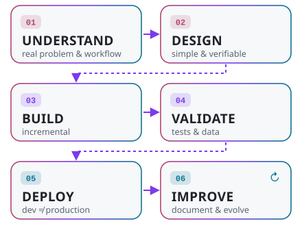

<p align="center">
  
</p>

<h1 align="center">Sergio Carey</h1>

<p align="center">
  <strong>Informatics Engineer</strong> · Backend · Applied AI · Automation<br/>
  <sub>📍 Arica, Chile &nbsp;·&nbsp; Building useful software for real-world problems</sub>
</p>

<p align="center">
  <picture>
    <source media="(prefers-color-scheme: dark)" srcset="./profile-assets/v3/tagline-en-dark.svg" />
    <source media="(prefers-color-scheme: light)" srcset="./profile-assets/v3/tagline-en-light.svg" />
    
  </picture>
</p>

<p align="center">
  <a href="https://sergio-portfolio-v2-roan.vercel.app"></a>
  <a href="https://www.linkedin.com/in/sergio-enrique-carey-alegre-58b318174/"></a>
  <a href="mailto:sergiocareyhola@gmail.com"></a>
</p>

<p align="center">
  <sub><a href="./README.md">🇨🇱 Español</a> &nbsp;·&nbsp; 🇬🇧 <strong>English</strong> &nbsp;·&nbsp; <a href="./README.pt-BR.md">🇧🇷 Português</a></sub>
</p>

##  About me


I build solutions for real-world problems by combining **backend engineering, databases, automation and applied artificial intelligence**. I am especially interested in turning concrete requirements into maintainable, useful software that can evolve over time.

```yaml
# sergio@github:~$ whoami
name: Sergio Carey
role: >-
  Informatics Engineer
based_in: Arica, Chile
focus:
  - Backend
  - Applied AI
  - Automation
building:
  - Web software
  - Desktop software
  - AI-powered tools
```

**🛠️ Building** — FastLaundry · Carey Assistant · Software tools<br/>
**🧠 Exploring** — Applied AI · LLMs · RAG · Automation<br/>
**📈 Growing in** — AI Engineering · Cloud · Data

<br clear="all" />

##  Tech ecosystem


My core is **backend development with Python and Django on PostgreSQL**, complemented by **TypeScript/React** interfaces, desktop apps built with **Tauri and Rust**, and **applied AI** with local models and APIs.


<br clear="all" />

| Area | Core technologies |
| --- | --- |
| 🧩 **Backend** | `Python` `Django` `REST APIs` |
| 🎨 **Frontend** | `TypeScript` `React` `Next.js` |
| 🗄️ **Databases** | `PostgreSQL` `MySQL` `SQLite` |
| 🧠 **Artificial intelligence** | `LLMs` `RAG` `Ollama` `AI APIs` |
| 🖥️ **Desktop & mobile** | `Tauri` `Rust` `Kotlin` `Android` |
| ☁️ **Cloud & infrastructure** | `Docker` `Linux` `Git/GitHub` `Heroku` `Vercel` |
| ⚙️ **Automation & integrations** | `Automated workflows` `Twilio` `External APIs` |

<details>
<summary><strong>View full technical inventory</strong></summary>

<br/>

| Category | Technologies & tools |
| --- | --- |
| **Backend** | Python, Django, Flask, REST APIs, business logic |
| **Frontend** | JavaScript, TypeScript, React, Next.js, Vue, HTML, CSS, Tailwind CSS |
| **Databases & data** | PostgreSQL, MySQL, SQLite, Jupyter Notebook |
| **Artificial intelligence** | Ollama, LLMs, assistants, prompting, RAG, AI APIs |
| **Desktop & mobile** | Tauri, Rust, Kotlin, Android |
| **Cloud & infrastructure** | Docker, Linux, Git/GitHub, Heroku, Vercel |
| **Automation & integrations** | Automated workflows, Twilio, external APIs, RSS/Atom and web services |

</details>

##  Featured projects

<table>
<tr>
<td>


**Software built for concrete needs:** the daily operations of a real business, desktop tools with local AI, web development and data science.

- 🧺 **FastLaundry** — operations management · in production
- 🤖 **Carey Assistant** — local AI for Windows · public releases
- 🌐 **Portfolio v2** — professional website · live demo
- 🚀 **Falcon 9 Landing Prediction** — data science · public notebook

</td>
</tr>
<tr>
<td>

### 🧺 FastLaundry

**Production management system for a real laundry business.**<br/>
**Solves:** the business's daily operations: customers, orders, cash management, payments, service tickets and deliveries.

`Python 3.12` `Django 5.2` `PostgreSQL`

 

</td>
</tr>
<tr>
<td>

### 🤖 Carey Assistant

**Windows desktop assistant focused on local AI, automation and productivity.**<br/>
**Solves:** access to local AI models and productivity automations from a local-first desktop app.

`Tauri` `React` `TypeScript` `Rust` `Ollama`

<a href="https://github.com/SC-Sergio/carey-assistant-releases/releases"></a>  <a href="https://github.com/SC-Sergio/carey-assistant-releases"></a>

</td>
</tr>
<tr>
<td>

### 🌐 Portfolio v2

**Modern professional portfolio with an interactive frontend, technology-focused identity and lightweight 3D experience.**<br/>
**Solves:** bringing projects, experience and contact together on a professional site of my own.

`Next.js` `React` `TypeScript` `Tailwind CSS` `Three.js`

<a href="https://github.com/SC-Sergio/sergio-portfolio-v2/actions/workflows/ci.yml"></a> <a href="https://sergio-portfolio-v2-roan.vercel.app"></a> <a href="https://github.com/SC-Sergio/sergio-portfolio-v2"></a>

</td>
</tr>
<tr>
<td>

### 🚀 Falcon 9 Landing Prediction

**Data science and machine learning project focused on Falcon 9 landing analysis and prediction.**<br/>
**Solves:** classifying whether the first stage will land successfully from launch data, using SQL, geospatial maps and classification models.

`Python` `Jupyter` `SQL` `Folium` `Machine Learning`

 <a href="https://github.com/SC-Sergio/SpaceX_Falcon9_Landing_Prediction"></a>

</td>
</tr>
</table>

<details>
<summary><strong>View more projects and repositories</strong></summary>

<br/>

- 🏟️ [CanchaClara](https://github.com/SC-Sergio/canchaclara) — sports field booking and management platform.
- 🔐 [Challenge Encriptador](https://github.com/SC-Sergio/challenge-encriptador)
- ☕ [Challenge ForoHub](https://github.com/SC-Sergio/ChallengeForoHub)
- 📚 [Literalura](https://github.com/SC-Sergio/Challengeliteralura)
- 💱 [Currency Converter](https://github.com/SC-Sergio/ChallengeConversordeMonedasAluraLatam)
- 📊 [Data Science Ecosystem](https://github.com/SC-Sergio/DataScienceEcosystem)
- 🧪 [All public repositories](https://github.com/SC-Sergio?tab=repositories)

</details>

##  Education & certifications


Professional degree in **Informatics Engineering** and verified certifications in **artificial intelligence, cybersecurity and data science**.

| Year | Education / certification |
| :---: | --- |
| **2026** | ☁️ **Oracle Cloud Infrastructure 2026 Certified AI Foundations Associate**<br/><sub>Oracle · Exam 1Z0-1122-26</sub> |
| **2026** | 🛡️ **Cisco Networking Academy · Cybersecurity Foundations**<br/><sub>Completion certificate and digital credential</sub> |
| **2024** | 🎓 **Informatics Engineering · INACAP**<br/><sub>Professional degree</sub> |
| **2024** | 📊 **IBM Data Science · Coursera**<br/><sub>12 completed courses</sub> |

<a href="https://www.linkedin.com/in/sergio-enrique-carey-alegre-58b318174/details/certifications/"></a>

<br clear="all" />

<details>
<summary><strong>View education and certifications in detail</strong></summary>

<br/>

### ☁️ Oracle Cloud Infrastructure 2026 Certified AI Foundations Associate

**Exam:** 1Z0-1122-26 · **Passed on September 2, 2026.**

Certification covering **artificial intelligence, machine learning and generative AI foundations in Oracle Cloud Infrastructure**.

### 🛡️ Cisco Networking Academy · Cybersecurity Foundations

Completed **Fundamentos de Ciberseguridad - Egresados INACAP** on **August 14, 2026**, earning a completion certificate and digital credential.

### 🎓 Informatics Engineering · INACAP

**Professional degree obtained on August 16, 2024.** The official INACAP certificate was issued on **September 24, 2024**.

Academic background in software development, databases, applied artificial intelligence, data and information systems.

### 📊 IBM Data Science · Coursera

Intensive **IBM Data Science learning path on Coursera**, with verified course completions between **June 27 and July 4, 2024**. Topics include Python, SQL, data analysis and visualization, machine learning, generative AI and a final SpaceX applied project.

<details>
<summary><strong>View completed courses</strong></summary>

- Python for Data Science, AI & Development
- What is Data Science?
- Tools for Data Science
- Data Science Methodology
- Python Project for Data Science
- Databases and SQL for Data Science with Python
- Data Analysis with Python
- Data Visualization with Python
- Machine Learning with Python
- Generative AI: Elevate Your Data Science Career
- Applied Data Science Capstone
- Data Scientist Career Guide and Interview Preparation

</details>

</details>

##  GitHub activity

<p align="center">
  <picture>
    <source media="(prefers-color-scheme: dark)" srcset="./profile-assets/contributions.dark.svg" />
    <source media="(prefers-color-scheme: light)" srcset="./profile-assets/contributions.light.svg" />
    
  </picture>
</p>

<p align="center">
  <picture>
    <source media="(prefers-color-scheme: dark)" srcset="https://raw.githubusercontent.com/SC-Sergio/SC-Sergio/output/github-contribution-grid-snake-dark.svg" />
    <source media="(prefers-color-scheme: light)" srcset="https://raw.githubusercontent.com/SC-Sergio/SC-Sergio/output/github-contribution-grid-snake.svg" />
    
  </picture>
</p>

<p align="center"><sub>Generated daily by GitHub Actions from the GitHub API: the card is stored in this repository and the animation in the <code>output</code> branch.</sub></p>

##  How I build software


I treat every project as an engineering cycle: **understand before building, validate before deploying and document to keep improving.**

<picture>
  <source media="(prefers-color-scheme: dark)" srcset="./profile-assets/v3/workflow-en-dark.svg" />
  <source media="(prefers-color-scheme: light)" srcset="./profile-assets/v3/workflow-en-light.svg" />
  
</picture>

<br clear="all" />

<details>
<summary><strong>View each stage in detail</strong></summary>

<br/>

1. **UNDERSTAND** — Understand the real problem and workflow before implementation.
2. **DESIGN** — Prefer a simple, maintainable and verifiable solution.
3. **BUILD** — Implement incrementally with clear boundaries.
4. **VALIDATE** — Test behavior, data integrity and regressions.
5. **DEPLOY** — Protect the separation between development and production.
6. **IMPROVE** — Document decisions and keep evolving the product.

</details>

##  Beyond code

Beyond software development, I enjoy **video games, anime, artificial intelligence and technology**. They are part of this profile's visual identity —including Mahiro, the mascot that accompanies each section— while the main focus remains technical and professional work.

<a href="https://steamcommunity.com/profiles/76561198080346056/"></a>

##  Let's connect

<p align="center">
  
</p>

<p align="center">
  <strong>Do you have a project, an idea or an opportunity?</strong><br/>
  Let's talk about backend, applied AI, automation or software collaboration.
</p>

<p align="center">
  <a href="https://sergio-portfolio-v2-roan.vercel.app"></a>
  <a href="https://www.linkedin.com/in/sergio-enrique-carey-alegre-58b318174/"></a>
  <a href="mailto:sergiocareyhola@gmail.com"></a>
</p>

<p align="center"><sub>Thanks for visiting my profile · Sergio Carey · Arica, Chile</sub></p>
