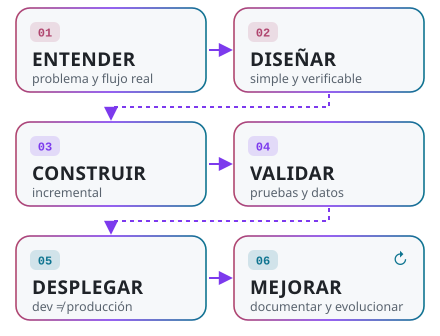

<p align="center">
  
</p>

<h1 align="center">Sergio Carey</h1>

<p align="center">
  <strong>Ingeniero en Informática</strong> · Backend · IA aplicada · Automatización<br/>
  <sub>📍 Arica, Chile &nbsp;·&nbsp; Construyendo software útil para problemas reales</sub>
</p>

<p align="center">
  <picture>
    <source media="(prefers-color-scheme: dark)" srcset="./profile-assets/v3/tagline-es-dark.svg" />
    <source media="(prefers-color-scheme: light)" srcset="./profile-assets/v3/tagline-es-light.svg" />
    
  </picture>
</p>

<p align="center">
  <a href="https://sergio-portfolio-v2-roan.vercel.app"></a>
  <a href="https://www.linkedin.com/in/sergio-enrique-carey-alegre-58b318174/"></a>
  <a href="mailto:sergiocareyhola@gmail.com"></a>
</p>

<p align="center">
  <sub>🇨🇱 <strong>Español</strong> &nbsp;·&nbsp; <a href="./README.en.md">🇬🇧 English</a> &nbsp;·&nbsp; <a href="./README.pt-BR.md">🇧🇷 Português</a></sub>
</p>

##  Sobre mí


Desarrollo soluciones orientadas a problemas reales, combinando **backend, bases de datos, automatización e inteligencia artificial aplicada**. Me interesa transformar necesidades concretas en software mantenible, útil y preparado para evolucionar.

```yaml
# sergio@github:~$ whoami
nombre: Sergio Carey
rol: >-
  Ingeniero en Informática
base: Arica, Chile
foco:
  - Backend
  - IA aplicada
  - Automatización
construye:
  - Software web
  - Software de escritorio
  - Herramientas con IA
```

**🛠️ Construyendo** — FastLaundry · Carey Assistant · Herramientas de software<br/>
**🧠 Explorando** — IA aplicada · LLMs · RAG · Automatización<br/>
**📈 Profundizando** — AI Engineering · Cloud · Datos

<br clear="all" />

##  Ecosistema tecnológico


Mi núcleo de trabajo es el **backend con Python y Django sobre PostgreSQL**, complementado con interfaces en **TypeScript/React**, aplicaciones de escritorio con **Tauri y Rust** e **IA aplicada** con modelos locales y APIs.


<br clear="all" />

| Área | Tecnologías principales |
| --- | --- |
| 🧩 **Backend** | `Python` `Django` `APIs REST` |
| 🎨 **Frontend** | `TypeScript` `React` `Next.js` |
| 🗄️ **Bases de datos** | `PostgreSQL` `MySQL` `SQLite` |
| 🧠 **Inteligencia artificial** | `LLMs` `RAG` `Ollama` `APIs de IA` |
| 🖥️ **Desktop y mobile** | `Tauri` `Rust` `Kotlin` `Android` |
| ☁️ **Cloud e infraestructura** | `Docker` `Linux` `Git/GitHub` `Heroku` `Vercel` |
| ⚙️ **Automatización e integraciones** | `Flujos automatizados` `Twilio` `APIs externas` |

<details>
<summary><strong>Ver inventario técnico completo</strong></summary>

<br/>

| Categoría | Tecnologías y herramientas |
| --- | --- |
| **Backend** | Python, Django, Flask, APIs REST, lógica de negocio |
| **Frontend** | JavaScript, TypeScript, React, Next.js, Vue, HTML, CSS, Tailwind CSS |
| **Bases de datos y datos** | PostgreSQL, MySQL, SQLite, Jupyter Notebook |
| **Inteligencia artificial** | Ollama, LLMs, asistentes, prompting, RAG, APIs de IA |
| **Desktop y mobile** | Tauri, Rust, Kotlin, Android |
| **Cloud e infraestructura** | Docker, Linux, Git/GitHub, Heroku, Vercel |
| **Automatización e integraciones** | Flujos automatizados, Twilio, APIs externas, RSS/Atom y servicios web |

</details>

##  Proyectos destacados

<table>
<tr>
<td>


**Software construido para necesidades concretas:** la operación diaria de un negocio real, herramientas de escritorio con IA local, desarrollo web y ciencia de datos.

- 🧺 **FastLaundry** — gestión operativa · en producción
- 🤖 **Carey Assistant** — IA local para Windows · releases públicas
- 🌐 **Portfolio v2** — sitio profesional · demo en vivo
- 🚀 **Falcon 9 Landing Prediction** — ciencia de datos · notebook público

</td>
</tr>
<tr>
<td>

### 🧺 FastLaundry

**Sistema de gestión operativo para una lavandería real.**<br/>
**Resuelve:** la operación diaria del negocio: clientes, pedidos, caja, pagos, guías y reparto.

`Python 3.12` `Django 5.2` `PostgreSQL`

 

</td>
</tr>
<tr>
<td>

### 🤖 Carey Assistant

**Asistente de escritorio para Windows enfocado en IA local, automatización y productividad.**<br/>
**Resuelve:** acceso a modelos de IA locales y automatizaciones de productividad desde una aplicación de escritorio local-first.

`Tauri` `React` `TypeScript` `Rust` `Ollama`

<a href="https://github.com/SC-Sergio/carey-assistant-releases/releases"></a>  <a href="https://github.com/SC-Sergio/carey-assistant-releases"></a>

</td>
</tr>
<tr>
<td>

### 🌐 Portfolio v2

**Portafolio profesional moderno con frontend interactivo, identidad tecnológica y experiencia 3D liviana.**<br/>
**Resuelve:** reunir proyectos, experiencia y contacto en un sitio profesional propio.

`Next.js` `React` `TypeScript` `Tailwind CSS` `Three.js`

<a href="https://github.com/SC-Sergio/sergio-portfolio-v2/actions/workflows/ci.yml"></a> <a href="https://sergio-portfolio-v2-roan.vercel.app"></a> <a href="https://github.com/SC-Sergio/sergio-portfolio-v2"></a>

</td>
</tr>
<tr>
<td>

### 🚀 Falcon 9 Landing Prediction

**Proyecto de ciencia de datos y machine learning centrado en análisis y predicción de aterrizajes del Falcon 9.**<br/>
**Resuelve:** clasificar si la primera etapa aterrizará con éxito a partir de datos de lanzamientos, con SQL, mapas geoespaciales y modelos de clasificación.

`Python` `Jupyter` `SQL` `Folium` `Machine Learning`

 <a href="https://github.com/SC-Sergio/SpaceX_Falcon9_Landing_Prediction"></a>

</td>
</tr>
</table>

<details>
<summary><strong>Ver otros proyectos y repositorios</strong></summary>

<br/>

- 🏟️ [CanchaClara](https://github.com/SC-Sergio/canchaclara) — plataforma para gestión y reserva de canchas deportivas.
- 🔐 [Challenge Encriptador](https://github.com/SC-Sergio/challenge-encriptador)
- ☕ [Challenge ForoHub](https://github.com/SC-Sergio/ChallengeForoHub)
- 📚 [Literalura](https://github.com/SC-Sergio/Challengeliteralura)
- 💱 [Conversor de Monedas](https://github.com/SC-Sergio/ChallengeConversordeMonedasAluraLatam)
- 📊 [Data Science Ecosystem](https://github.com/SC-Sergio/DataScienceEcosystem)
- 🧪 [Todos mis repositorios públicos](https://github.com/SC-Sergio?tab=repositories)

</details>

##  Formación y certificaciones


Título profesional en **Ingeniería en Informática** y certificaciones verificadas en **inteligencia artificial, ciberseguridad y ciencia de datos**.

| Año | Formación / certificación |
| :---: | --- |
| **2026** | ☁️ **Oracle Cloud Infrastructure 2026 Certified AI Foundations Associate**<br/><sub>Oracle · Examen 1Z0-1122-26</sub> |
| **2026** | 🛡️ **Cisco Networking Academy · Fundamentos de Ciberseguridad**<br/><sub>Certificado de finalización y credencial digital</sub> |
| **2024** | 🎓 **Ingeniería en Informática · INACAP**<br/><sub>Título profesional</sub> |
| **2024** | 📊 **IBM Data Science · Coursera**<br/><sub>12 cursos completados</sub> |

<a href="https://www.linkedin.com/in/sergio-enrique-carey-alegre-58b318174/details/certifications/"></a>

<br clear="all" />

<details>
<summary><strong>Ver formación y certificaciones en detalle</strong></summary>

<br/>

### ☁️ Oracle Cloud Infrastructure 2026 Certified AI Foundations Associate

**Examen:** 1Z0-1122-26 · **Aprobado el 2 de septiembre de 2026.**

Certificación de fundamentos de **inteligencia artificial, machine learning e IA generativa en Oracle Cloud Infrastructure**.

### 🛡️ Cisco Networking Academy · Fundamentos de Ciberseguridad

**Fundamentos de Ciberseguridad - Egresados INACAP** · Completado el **14 de agosto de 2026**, con certificado de finalización y credencial digital.

### 🎓 Ingeniería en Informática · INACAP

**Título profesional obtenido el 16 de agosto de 2024.** El certificado oficial de INACAP fue emitido el **24 de septiembre de 2024**.

Formación en desarrollo de software, bases de datos, inteligencia artificial aplicada, datos y construcción de soluciones informáticas.

### 📊 IBM Data Science · Coursera

Trayectoria intensiva de cursos de **IBM Data Science en Coursera**, con cursos completados entre el **27 de junio y el 4 de julio de 2024**. Incluye Python, SQL, análisis y visualización de datos, machine learning, IA generativa y proyecto final aplicado a SpaceX.

<details>
<summary><strong>Ver cursos completados verificados</strong></summary>

- Python for Data Science, AI & Development
- What is Data Science?
- Tools for Data Science
- Data Science Methodology
- Python Project for Data Science
- Databases and SQL for Data Science with Python
- Data Analysis with Python
- Data Visualization with Python
- Machine Learning with Python
- Generative AI: Elevate Your Data Science Career
- Applied Data Science Capstone
- Data Scientist Career Guide and Interview Preparation

</details>

</details>

##  Actividad en GitHub

<p align="center">
  <picture>
    <source media="(prefers-color-scheme: dark)" srcset="./profile-assets/contributions.dark.svg" />
    <source media="(prefers-color-scheme: light)" srcset="./profile-assets/contributions.light.svg" />
    
  </picture>
</p>

<p align="center">
  <picture>
    <source media="(prefers-color-scheme: dark)" srcset="https://raw.githubusercontent.com/SC-Sergio/SC-Sergio/output/github-contribution-grid-snake-dark.svg" />
    <source media="(prefers-color-scheme: light)" srcset="https://raw.githubusercontent.com/SC-Sergio/SC-Sergio/output/github-contribution-grid-snake.svg" />
    
  </picture>
</p>

<p align="center"><sub>Generado a diario por GitHub Actions desde la API de GitHub: la tarjeta se guarda en este repositorio y la animación en la rama <code>output</code>.</sub></p>

##  Cómo desarrollo software


Trato cada proyecto como un ciclo de ingeniería: **entender antes de construir, validar antes de desplegar y documentar para seguir mejorando.**

<picture>
  <source media="(prefers-color-scheme: dark)" srcset="./profile-assets/v3/workflow-es-dark.svg" />
  <source media="(prefers-color-scheme: light)" srcset="./profile-assets/v3/workflow-es-light.svg" />
  
</picture>

<br clear="all" />

<details>
<summary><strong>Ver el detalle de cada etapa</strong></summary>

<br/>

1. **ENTENDER** — Entender el problema y el flujo real antes de implementar.
2. **DISEÑAR** — Priorizar una solución simple, mantenible y verificable.
3. **CONSTRUIR** — Implementar de forma incremental y con límites claros.
4. **VALIDAR** — Probar comportamiento, integridad de datos y regresiones.
5. **DESPLEGAR** — Proteger la separación entre desarrollo y producción.
6. **MEJORAR** — Documentar decisiones y seguir evolucionando el producto.

</details>

##  Más allá del código

Además del desarrollo de software, me interesan los **videojuegos, el anime, la inteligencia artificial y la tecnología**. Son parte de la identidad visual de este perfil —incluida Mahiro, la mascota que acompaña cada sección—, manteniendo siempre el foco principal en proyectos técnicos y profesionales.

<a href="https://steamcommunity.com/profiles/76561198080346056/"></a>

##  Conectemos

<p align="center">
  
</p>

<p align="center">
  <strong>¿Tienes un proyecto, una idea o una oportunidad?</strong><br/>
  Conversemos sobre backend, IA aplicada, automatización o colaboración en software.
</p>

<p align="center">
  <a href="https://sergio-portfolio-v2-roan.vercel.app"></a>
  <a href="https://www.linkedin.com/in/sergio-enrique-carey-alegre-58b318174/"></a>
  <a href="mailto:sergiocareyhola@gmail.com"></a>
</p>

<p align="center"><sub>Gracias por visitar mi perfil · Sergio Carey · Arica, Chile</sub></p>
