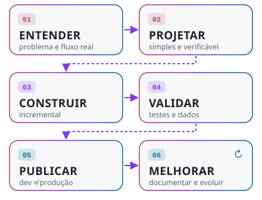

<p align="center">
  
</p>

<h1 align="center">Sergio Carey</h1>

<p align="center">
  <strong>Engenheiro de Informática</strong> · Backend · IA aplicada · Automação<br/>
  <sub>📍 Arica, Chile &nbsp;·&nbsp; Desenvolvendo software útil para problemas reais</sub>
</p>

<p align="center">
  <picture>
    <source media="(prefers-color-scheme: dark)" srcset="./profile-assets/v3/tagline-pt-dark.svg" />
    <source media="(prefers-color-scheme: light)" srcset="./profile-assets/v3/tagline-pt-light.svg" />
    
  </picture>
</p>

<p align="center">
  <a href="https://sergio-portfolio-v2-roan.vercel.app"></a>
  <a href="https://www.linkedin.com/in/sergio-enrique-carey-alegre-58b318174/"></a>
  <a href="mailto:sergiocareyhola@gmail.com"></a>
</p>

<p align="center">
  <sub><a href="./README.md">🇨🇱 Español</a> &nbsp;·&nbsp; <a href="./README.en.md">🇬🇧 English</a> &nbsp;·&nbsp; 🇧🇷 <strong>Português</strong></sub>
</p>

##  Sobre mim


Desenvolvo soluções para problemas reais combinando **backend, bancos de dados, automação e inteligência artificial aplicada**. Tenho especial interesse em transformar necessidades concretas em software sustentável, útil e preparado para evoluir.

```yaml
# sergio@github:~$ whoami
nome: Sergio Carey
funcao: >-
  Engenheiro de Informática
base: Arica, Chile
foco:
  - Backend
  - IA aplicada
  - Automação
construo:
  - Software web
  - Software desktop
  - Ferramentas com IA
```

**🛠️ Construindo** — FastLaundry · Carey Assistant · Ferramentas de software<br/>
**🧠 Explorando** — IA aplicada · LLMs · RAG · Automação<br/>
**📈 Aprofundando** — AI Engineering · Cloud · Dados

<br clear="all" />

##  Ecossistema tecnológico


Meu núcleo de trabalho é o **backend com Python e Django sobre PostgreSQL**, complementado por interfaces em **TypeScript/React**, aplicações desktop com **Tauri e Rust** e **IA aplicada** com modelos locais e APIs.


<br clear="all" />

| Área | Tecnologias principais |
| --- | --- |
| 🧩 **Backend** | `Python` `Django` `APIs REST` |
| 🎨 **Frontend** | `TypeScript` `React` `Next.js` |
| 🗄️ **Bancos de dados** | `PostgreSQL` `MySQL` `SQLite` |
| 🧠 **Inteligência artificial** | `LLMs` `RAG` `Ollama` `APIs de IA` |
| 🖥️ **Desktop e mobile** | `Tauri` `Rust` `Kotlin` `Android` |
| ☁️ **Cloud e infraestrutura** | `Docker` `Linux` `Git/GitHub` `Heroku` `Vercel` |
| ⚙️ **Automação e integrações** | `Fluxos automatizados` `Twilio` `APIs externas` |

<details>
<summary><strong>Ver inventário técnico completo</strong></summary>

<br/>

| Categoria | Tecnologias e ferramentas |
| --- | --- |
| **Backend** | Python, Django, Flask, APIs REST, lógica de negócio |
| **Frontend** | JavaScript, TypeScript, React, Next.js, Vue, HTML, CSS, Tailwind CSS |
| **Bancos de dados e dados** | PostgreSQL, MySQL, SQLite, Jupyter Notebook |
| **Inteligência artificial** | Ollama, LLMs, assistentes, prompting, RAG, APIs de IA |
| **Desktop e mobile** | Tauri, Rust, Kotlin, Android |
| **Cloud e infraestrutura** | Docker, Linux, Git/GitHub, Heroku, Vercel |
| **Automação e integrações** | Fluxos automatizados, Twilio, APIs externas, RSS/Atom e serviços web |

</details>

##  Projetos em destaque

<table>
<tr>
<td>


**Software construído para necessidades concretas:** a operação diária de um negócio real, ferramentas desktop com IA local, desenvolvimento web e ciência de dados.

- 🧺 **FastLaundry** — gestão operacional · em produção
- 🤖 **Carey Assistant** — IA local para Windows · releases públicas
- 🌐 **Portfolio v2** — site profissional · demo ao vivo
- 🚀 **Falcon 9 Landing Prediction** — ciência de dados · notebook público

</td>
</tr>
<tr>
<td>

### 🧺 FastLaundry

**Sistema de gestão em produção para uma lavanderia real.**<br/>
**Resolve:** a operação diária do negócio: clientes, pedidos, caixa, pagamentos, guias e entregas.

`Python 3.12` `Django 5.2` `PostgreSQL`

 

</td>
</tr>
<tr>
<td>

### 🤖 Carey Assistant

**Assistente desktop para Windows focado em IA local, automação e produtividade.**<br/>
**Resolve:** acesso a modelos de IA locais e automações de produtividade a partir de um aplicativo desktop local-first.

`Tauri` `React` `TypeScript` `Rust` `Ollama`

<a href="https://github.com/SC-Sergio/carey-assistant-releases/releases"></a>  <a href="https://github.com/SC-Sergio/carey-assistant-releases"></a>

</td>
</tr>
<tr>
<td>

### 🌐 Portfolio v2

**Portfolio profissional moderno com frontend interativo, identidade tecnológica e experiência 3D leve.**<br/>
**Resolve:** reunir projetos, experiência e contato em um site profissional próprio.

`Next.js` `React` `TypeScript` `Tailwind CSS` `Three.js`

<a href="https://github.com/SC-Sergio/sergio-portfolio-v2/actions/workflows/ci.yml"></a> <a href="https://sergio-portfolio-v2-roan.vercel.app"></a> <a href="https://github.com/SC-Sergio/sergio-portfolio-v2"></a>

</td>
</tr>
<tr>
<td>

### 🚀 Falcon 9 Landing Prediction

**Projeto de ciência de dados e machine learning focado em análise e previsão de pousos do Falcon 9.**<br/>
**Resolve:** classificar se o primeiro estágio pousará com sucesso a partir de dados de lançamentos, com SQL, mapas geoespaciais e modelos de classificação.

`Python` `Jupyter` `SQL` `Folium` `Machine Learning`

 <a href="https://github.com/SC-Sergio/SpaceX_Falcon9_Landing_Prediction"></a>

</td>
</tr>
</table>

<details>
<summary><strong>Ver outros projetos e repositórios</strong></summary>

<br/>

- 🏟️ [CanchaClara](https://github.com/SC-Sergio/canchaclara) — plataforma para gestão e reserva de quadras esportivas.
- 🔐 [Challenge Encriptador](https://github.com/SC-Sergio/challenge-encriptador)
- ☕ [Challenge ForoHub](https://github.com/SC-Sergio/ChallengeForoHub)
- 📚 [Literalura](https://github.com/SC-Sergio/Challengeliteralura)
- 💱 [Conversor de Moedas](https://github.com/SC-Sergio/ChallengeConversordeMonedasAluraLatam)
- 📊 [Data Science Ecosystem](https://github.com/SC-Sergio/DataScienceEcosystem)
- 🧪 [Todos os repositórios públicos](https://github.com/SC-Sergio?tab=repositories)

</details>

##  Formação e certificações


Título profissional em **Engenharia de Informática** e certificações verificadas em **inteligência artificial, cibersegurança e ciência de dados**.

| Ano | Formação / certificação |
| :---: | --- |
| **2026** | ☁️ **Oracle Cloud Infrastructure 2026 Certified AI Foundations Associate**<br/><sub>Oracle · Exame 1Z0-1122-26</sub> |
| **2026** | 🛡️ **Cisco Networking Academy · Fundamentos de Ciberseguridad**<br/><sub>Certificado de conclusão e credencial digital</sub> |
| **2024** | 🎓 **Engenharia de Informática · INACAP**<br/><sub>Título profissional</sub> |
| **2024** | 📊 **IBM Data Science · Coursera**<br/><sub>12 cursos concluídos</sub> |

<a href="https://www.linkedin.com/in/sergio-enrique-carey-alegre-58b318174/details/certifications/"></a>

<br clear="all" />

<details>
<summary><strong>Ver formação e certificações em detalhe</strong></summary>

<br/>

### ☁️ Oracle Cloud Infrastructure 2026 Certified AI Foundations Associate

**Exame:** 1Z0-1122-26 · **Aprovado em 2 de setembro de 2026.**

Certificação sobre fundamentos de **inteligência artificial, machine learning e IA generativa no Oracle Cloud Infrastructure**.

### 🛡️ Cisco Networking Academy · Fundamentos de Ciberseguridad

Concluí **Fundamentos de Ciberseguridad - Egresados INACAP** em **14 de agosto de 2026**, obtendo certificado de conclusão e credencial digital.

### 🎓 Engenharia de Informática · INACAP

**Título profissional obtido em 16 de agosto de 2024.** O certificado oficial do INACAP foi emitido em **24 de setembro de 2024**.

Formação em desenvolvimento de software, bancos de dados, inteligência artificial aplicada, dados e sistemas de informação.

### 📊 IBM Data Science · Coursera

Trajetória intensiva de **IBM Data Science na Coursera**, com conclusões verificadas entre **27 de junho e 4 de julho de 2024**. Inclui Python, SQL, análise e visualização de dados, machine learning, IA generativa e projeto final aplicado à SpaceX.

<details>
<summary><strong>Ver cursos concluídos</strong></summary>

- Python for Data Science, AI & Development
- What is Data Science?
- Tools for Data Science
- Data Science Methodology
- Python Project for Data Science
- Databases and SQL for Data Science with Python
- Data Analysis with Python
- Data Visualization with Python
- Machine Learning with Python
- Generative AI: Elevate Your Data Science Career
- Applied Data Science Capstone
- Data Scientist Career Guide and Interview Preparation

</details>

</details>

##  Atividade no GitHub

<p align="center">
  <picture>
    <source media="(prefers-color-scheme: dark)" srcset="./profile-assets/contributions.dark.svg" />
    <source media="(prefers-color-scheme: light)" srcset="./profile-assets/contributions.light.svg" />
    
  </picture>
</p>

<p align="center">
  <picture>
    <source media="(prefers-color-scheme: dark)" srcset="https://raw.githubusercontent.com/SC-Sergio/SC-Sergio/output/github-contribution-grid-snake-dark.svg" />
    <source media="(prefers-color-scheme: light)" srcset="https://raw.githubusercontent.com/SC-Sergio/SC-Sergio/output/github-contribution-grid-snake.svg" />
    
  </picture>
</p>

<p align="center"><sub>Gerado diariamente por GitHub Actions a partir da API do GitHub: o cartão fica neste repositório e a animação no branch <code>output</code>.</sub></p>

##  Como desenvolvo software


Trato cada projeto como um ciclo de engenharia: **entender antes de construir, validar antes de publicar e documentar para continuar melhorando.**

<picture>
  <source media="(prefers-color-scheme: dark)" srcset="./profile-assets/v3/workflow-pt-dark.svg" />
  <source media="(prefers-color-scheme: light)" srcset="./profile-assets/v3/workflow-pt-light.svg" />
  
</picture>

<br clear="all" />

<details>
<summary><strong>Ver o detalhe de cada etapa</strong></summary>

<br/>

1. **ENTENDER** — Entender o problema e o fluxo real antes de implementar.
2. **PROJETAR** — Priorizar uma solução simples, sustentável e verificável.
3. **CONSTRUIR** — Implementar de forma incremental e com limites claros.
4. **VALIDAR** — Testar comportamento, integridade dos dados e regressões.
5. **PUBLICAR** — Proteger a separação entre desenvolvimento e produção.
6. **MELHORAR** — Documentar decisões e continuar evoluindo o produto.

</details>

##  Além do código

Além do desenvolvimento de software, gosto de **videogames, anime, inteligência artificial e tecnologia**. Esses interesses fazem parte da identidade visual deste perfil —incluindo Mahiro, a mascote que acompanha cada seção—, mantendo sempre o foco principal em projetos técnicos e profissionais.

<a href="https://steamcommunity.com/profiles/76561198080346056/"></a>

##  Vamos conversar

<p align="center">
  
</p>

<p align="center">
  <strong>Tem um projeto, uma ideia ou uma oportunidade?</strong><br/>
  Vamos conversar sobre backend, IA aplicada, automação ou colaboração em software.
</p>

<p align="center">
  <a href="https://sergio-portfolio-v2-roan.vercel.app"></a>
  <a href="https://www.linkedin.com/in/sergio-enrique-carey-alegre-58b318174/"></a>
  <a href="mailto:sergiocareyhola@gmail.com"></a>
</p>

<p align="center"><sub>Obrigado por visitar meu perfil · Sergio Carey · Arica, Chile</sub></p>
